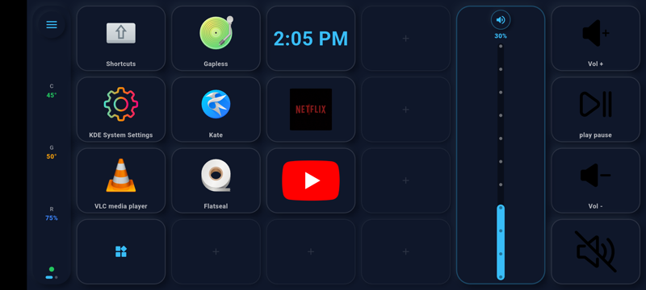
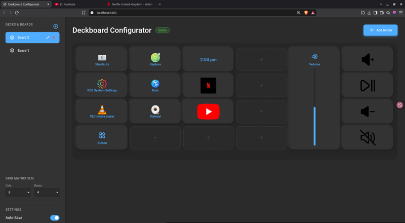
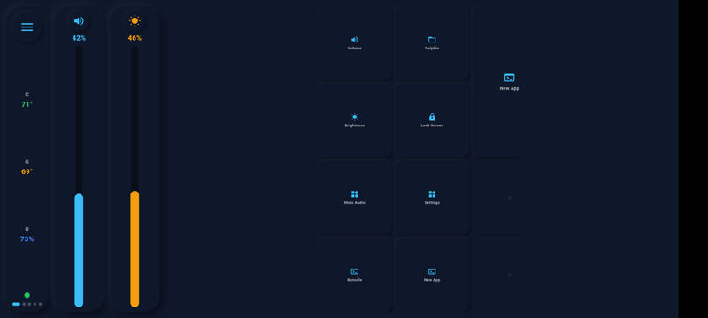

# KDE Deck 🚀

**Turn an old Android phone into a Stream Deck for Linux. $0.**

KDE Deck is an open-source macro pad / deck controller for **Linux (KDE Plasma 6, Wayland & X11)**. Instead of paying Elgato money, you run a lightweight server on your PC and drive it from your phone: launch approved apps, control media, slide volume and brightness, ring your phone, manage windows — a full remote for your Linux box, built from scratch.

The current release line is Linux-first. Windows and macOS support are planned
platform adapters, not supported system-control backends yet.


*One tap on the phone opens YouTube on the monitor, media buttons drive playback and volume, and the last tap opens system settings.*

---

## 📸 Screenshots & Media

| Phone deck | Board configurator | Volume & brightness sliders |
|---|---|---|
|  |  |  |

---

## 🏗️ Architecture & Technologies

We recently migrated from a Python prototype to a highly robust **Dart and Flutter** ecosystem to ensure zero-latency WebSockets, beautiful UI animations, and native system integration without forcing users to install bulky runtime environments (like Node.js or Python virtual environments).

* **Backend Daemon:** Written in pure Dart. It compiles into a single, standalone AOT executable (`kdedeck_daemon`) with an incredibly small memory footprint. It natively manages D-Bus MPRIS controls and parses system/Flatpak `.desktop` application icons.
* **Frontend Mobile App:** A stunning **Neumorphic** Android application built with Flutter. It connects to the daemon via WebSockets and updates button matrix grids instantly.
* **Frontend Web App:** The daemon also hosts a Web UI at `http://localhost:8484` for dragging and dropping configurations directly on your PC.

---

## ⚡ Installation (For New Users)

**You do NOT need to install Dart, Flutter, Python, or any heavy SDKs to use KDE Deck.** 
We provide fully compiled, standalone binaries.

### 1. The Linux Backend
1. Download the compiled `kdedeck_daemon` executable.
2. Run it from a terminal on the Linux PC:
   ```bash
   ./kdedeck_daemon
   ```
3. By default, the daemon listens on loopback only and still requires a paired
   WebSocket client. Use `--pair` in the same terminal to create a one-time
   pairing code, or `--version` to inspect the artifact without starting a
   listener.

For phone/LAN access, configure `allow_lan: true` and provide a certificate and
matching private key through `KDEDECK_TLS_CERT_FILE` and
`KDEDECK_TLS_KEY_FILE`. LAN mode requires HTTPS/WSS; it does not fall back to
plaintext HTTP/WS. See [`docs/security/tls-setup.md`](docs/security/tls-setup.md)
before exposing the daemon beyond the local machine.

Durable daemon sessions are an explicit opt-in. Set
`KDEDECK_SESSION_PERSISTENCE=required` to retain session fingerprints across a
restart. The daemon fails closed if the private session store cannot be created,
read, or updated; it never falls back to an in-memory session table in this
mode. Leave the variable unset or set to `disabled` for the default in-memory
behaviour.

To inspect the daemon release identity without starting a listener:

```bash
./kdedeck_daemon --version
```

### 2. The Android Frontend
1. Download the `app-release.apk` file to your Android phone.
2. Install the APK.
3. Open the app, create a connection profile, and choose a secure HTTPS/WSS
   connection for a LAN address such as `192.168.1.50`.
4. Pair using the one-time code from the daemon's local terminal. The app stores
   only the issued bearer token in platform secure storage.

For a self-signed certificate, the phone must trust the certificate through a
separately verified provisioning process. KDE Deck does not disable certificate
validation or accept every certificate.

### 3. The Web Configurator
1. On your PC, open a web browser.
2. Navigate to `http://localhost:8484` for a loopback daemon, or the matching
   `https://<certificate-hostname>:8484` URL for a TLS-enabled LAN daemon.
3. Pair the browser when prompted, then use the drag-and-drop interface to
   customize your button grid.

---

## 🌍 Cross-Platform Roadmap (Windows & macOS)

Are we bringing this to Windows and Mac? **Yes!** Our architecture is perfectly suited for it.

Because we built the mobile app in Flutter, the client UI is structured for
Android, iOS, and desktop builds. Because we built the backend in Dart, the
server core can compile for `.exe` (Windows) and Mach-O (macOS) binaries.
Compilation alone is not platform parity: the native system-action adapters
and application discovery for those platforms are still pending.

Currently, the backend's `SystemActionsService` uses Linux-specific commands
(like `dbus-send` and parsing `/usr/share/applications`). Future work must add
tested platform adapters for:
* **Windows:** Parsing the Start Menu and hooking into the Windows Media API.
* **macOS:** Hooking into AppleScript for media controls.

The goal is to preserve the existing UI and WebSocket protocol while exposing
capabilities explicitly where an operating system does not support an action.

---

## 🛠️ Building and testing from source

The repository contains a standalone Dart daemon, a static browser
configurator, a Go tray wrapper, and a Flutter client. The reproducible Docker
path builds and runs the standalone daemon and browser configurator; Android,
desktop Flutter, and the native tray remain host builds because they require
platform SDKs and desktop integration.

### Prerequisites

- Dart SDK `3.13.1`
- Flutter `3.47.1` with the SDK revision recorded in
  [`kdedeck_mobile/.metadata`](kdedeck_mobile/.metadata)
- Go `1.25.0` or newer within the module's supported toolchain line
- Node.js `22.23.1` (see [`.nvmrc`](.nvmrc))
- Docker Engine `29.9.0` or a compatible recent Docker release for the
  container workflow
- Linux tray development package: `libayatana-appindicator3-dev`

Install dependencies in each component before the first local build:

```bash
dart pub get --directory deckboard_daemon/backend
flutter pub get --directory kdedeck_mobile
go -C deckboard_daemon/tray mod download
```

On Debian/Ubuntu before running the tray checks, install the native tray
dependency:

```bash
sudo apt-get update
sudo apt-get install --no-install-recommends libayatana-appindicator3-dev
```

Run the complete repository check with one command:

```bash
make test
```

This runs the serial backend suite, browser tests and syntax checks, Go tests
and vet, and Flutter tests. After dependencies are installed, it does not
download anything.

Pull requests and pushes to `main` run the same locked checks in GitHub Actions.
The workflow also verifies Dart analysis and formatting, installs the Android
SDK platform/build tools required by the pinned project, builds the standalone
daemon, builds the Android release APK, and builds the Docker image. The
workflow artifacts are validation outputs, not signed public release packages.

Build local artifacts with:

```bash
cd deckboard_daemon/backend
dart compile exe bin/backend.dart -o kdedeck_daemon
cd ../..
cd kdedeck_mobile
flutter build apk --release
```

### Docker build and run

Build the standalone daemon image from the repository root:

```bash
docker build --tag kdedeck-daemon .
```

Run it on a Linux host using host networking. The checked-in default config is
loopback-only, so this keeps the daemon available at `http://localhost:8484`
without exposing it to the LAN:

```bash
docker volume create kdedeck-config
docker run --rm --network host \
  --volume kdedeck-config:/opt/kdedeck/backend \
  kdedeck-daemon
```

The container uses the committed backend lockfile during its build and runs as
an unprivileged `kdedeck` user. For phone/LAN access, provide a deliberately
configured TLS certificate/key and an `allow_lan: true` configuration; the
daemon never downgrades LAN mode to plaintext.

The container is a daemon deployment target, not an Android build image and
not a replacement for the host-integrated Flutter desktop or Go tray builds.

### Reproducibility checklist

- [x] **Dependency lockfiles:** committed `deckboard_daemon/backend/pubspec.lock`,
  `kdedeck_mobile/pubspec.lock`, and `deckboard_daemon/tray/go.sum` pin the
  Dart, Flutter, and Go dependencies used by this repository.
- [x] **No machine-specific absolute paths:** tracked source, documentation,
  and the checked-in sample configuration contain no paths from the developer's
  workstation. Runtime host paths are supplied by the operating system or
  environment variables instead.
- [x] **Pinned runtimes:** `.nvmrc`, `go.mod`, the Flutter project metadata,
  and the pinned Dart Docker image record the supported toolchain versions.
- [x] **Reproducible checks:** `make test` is the single repository test entry
  point after dependencies have been installed.

### Deployment checklist

1. Run `make test`.
2. Build and inspect the daemon with `docker build --tag kdedeck-daemon .` or
   `dart compile exe`.
3. Keep TLS private keys, pairing overrides, and local application registries
   outside Git; use `.env.example` as the variable reference.
4. For LAN deployments, verify certificate hostname/trust and pair the phone
   through the local terminal before using the daemon.

---

## 🌐 About & Website

KDE Deck is rapidly evolving. We are planning to host a dedicated documentation and showcase website! 

Because this repository is public, you can easily view our auto-generated project website hosted directly from this README via **GitHub Pages**. 
*(To enable this on your fork: Go to GitHub Repository Settings -> Pages -> Build and deployment -> Source: Deploy from a branch -> Select `main`).*

## License 📜
Distributed under the MIT License.
